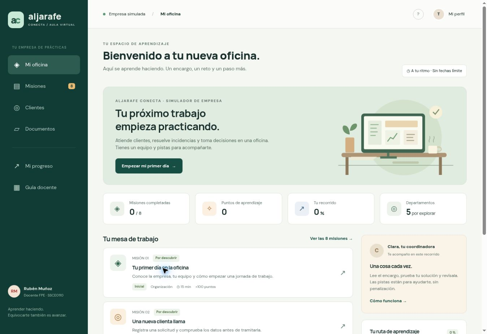

# Aljarafe Conecta · Empresa virtual educativa

**Diseño educativo: Rubén Muñoz Valadés · Rubén Muñoz Docente.**

Simulador de una pequeña empresa de suministros de oficina y servicios digitales ubicada ficticiamente en Mairena del Aljarafe. Enseña mediante ocho encargos conectados, con datos ficticios, pistas, comprobaciones y evidencias descargables.

[Abrir la empresa virtual](https://rumuva.github.io/empresa-virtual-educativa/dist/)



## Empezar

La aplicación está en `dist/`. Se puede alojar directamente en GitHub Pages o cualquier servidor estático. No requiere instalación, claves de API ni proceso de compilación.

Para servirla en local, desde esta carpeta:

```bash
python -m http.server 8080 --directory dist
```

Abrir http://localhost:8080 en un navegador moderno. Los módulos JavaScript requieren HTTP; no abrir index.html directamente como archivo.

## Recorrido

| Misión | Competencia | Duración orientativa |
| --- | --- | --- |
| 01 · Tu primer día | Organización y documentación | 15 min |
| 02 · Una nueva clienta | Registro de datos y necesidades | 25 min |
| 03 · La factura que no cuadra | Cálculo de base, IVA y diferencia | 35 min |
| 04 · Responder una reclamación | Comunicación escrita y empatía | 30 min |
| 05 · Comparar proveedores | Decisiones de compra justificadas | 25 min |
| 06 · Limpiar ventas | Limpieza de datos y resumen en Excel | 40 min |
| 07 · Gestionar una cita | Disponibilidad y solapamientos | 20 min |
| 08 · Cerrar la jornada | Informe integrado | 40 min |

230 minutos de actividad. Propuesta de aula: tres sesiones de dos horas, incluidas explicación y reflexión. No es una acreditación oficial ni sustituye un programa formativo reglado.

## Bienvenida y acompañamiento

La primera entrada presenta una bienvenida guiada en cuatro pasos: conocer la empresa, entender el recorrido, ensayar los botones con un ejemplo sin nota y comenzar. El acceso «Cómo empezar» permite repetirla sin borrar respuestas. Se puede omitir expresamente para entrar a la oficina.

La oficina destaca la primera misión pendiente y un mapa ordenado de las ocho actividades. Cada misión se divide en leer el encargo, hacer la actividad y revisar para continuar. Al retomar se abre el paso adecuado a sus borradores o resultados. Las copias antiguas conservan el trabajo y reciben la nueva bienvenida. No se bloquea la consulta de otras actividades.

## Funciones

- Panel de oficina, ocho misiones, búsqueda y filtros por departamento y nivel.
- Casos conectados, formularios, pistas y revisiones sin penalizar intentos.
- Directorio ficticio que incorpora la ficha de la misión 02 al superarla.
- CSV para Excel con pedido, ventas y clientes; plantilla e informes de texto.
- Progreso persistente en el navegador, copia y recuperación manual entre dispositivos.
- Informe imprimible: usar «Imprimir / Guardar PDF» y elegir el destino PDF del navegador.
- Guía docente pública, soluciones y rúbrica orientativa.
- Instrucciones contextualizadas para practicar con un tutor en ChatGPT.
- Diseño adaptable a móvil y escritorio, navegación por teclado y controles etiquetados.

## Alcance de la IA y la evaluación

La aplicación no incluye un modelo generativo ni usa una API de IA. Los personajes, mensajes y pistas del simulador son contenido preparado. El botón de práctica con IA permite copiar un encargo y abrir ChatGPT; el usuario decide qué pega en ese servicio. El acceso y los límites de ese servicio son independientes.

Las revisiones numéricas comprueban resultados concretos. Las revisiones de texto buscan elementos y cifras mediante reglas: no comprenden toda la intención y pueden producir falsos positivos o negativos. El docente debe revisar exactitud, tono, argumentación y coherencia antes de calificar. El porcentaje representa comprobaciones superadas, no una nota oficial. Las soluciones son visibles en código y en la guía: el diseño es para práctica formativa, no para un examen seguro.

## Datos y privacidad

Todos los negocios, personas y correos del caso son ficticios; los dominios `.example` no son buzones reales. No hay envío de correo, compra, cobro ni reserva real de citas. Usar alias, no datos personales reales.

El navegador conserva alias, borradores, intentos, pistas y resultados mediante `localStorage`. No hay autenticación, base de datos compartida ni panel para consultar otros alumnos. Cada navegador/origen mantiene su recorrido. Descargar una copia antes de cambiar de dispositivo, cambiar de dirección web, limpiar el navegador o compartir ordenador. La recuperación sustituye el recorrido actual tras confirmación y recalcula las comprobaciones. Si el almacenamiento está bloqueado, se muestra un aviso y debe descargarse una copia antes de salir.

La tipografía intenta cargar Google Fonts y dispone de fuentes de sistema como alternativa. La navegación externa a ChatGPT se produce solo al pulsar su enlace. El simulador no envía las respuestas a ese servicio.

## Docencia

Rúbrica sugerida: exactitud de datos 40 %, claridad y trato 25 %, justificación 20 %, revisión y presentación 15 %. Se puede trabajar individualmente o por parejas alternando administración y atención al cliente. Recoger los informes por el canal del centro, con revisión docente.

## Verificación

Requiere Node.js para las pruebas, no para usar la web:

```bash
npm run check
npm test
```

Las pruebas cubren las ocho evaluaciones, formato monetario, reconciliación de las ventas, rechazo de copias malformadas y recálculo de resultados importados. La validación de interfaz se realiza además en navegador.

## Estructura

- `dist/index.html`: estructura y navegación.
- `dist/styles.css`: diseño adaptable y estilos de impresión.
- `dist/data.js`: empresa, clientes, ventas, misiones y soluciones.
- `dist/engine.js`: reglas de comprobación y validación de copias.
- `dist/app.js`: interfaz, persistencia, descargas y rutas.
- `tests/engine.test.js`: verificaciones de coherencia y recuperación.

Para ampliar: incorporar nuevas misiones y casos, elaborar materiales externos o añadir un backend con autenticación, seguimiento de grupo y un servicio de IA bajo un proyecto separado. Estas funciones no forman parte de esta versión.

## Prompt maestro de producto

Las instrucciones completas de diseño, pedagogía, experiencia de usuario, implementación y validación se conservan en [docs/PROMPT_MAESTRO_ACADEMIA.md](docs/PROMPT_MAESTRO_ACADEMIA.md).

La versión 1.1.1 conserva el paso exacto al recuperar una actividad, añade regreso desde materiales de apoyo y permite ir desde una comprobación fallida al campo que debe revisarse.
